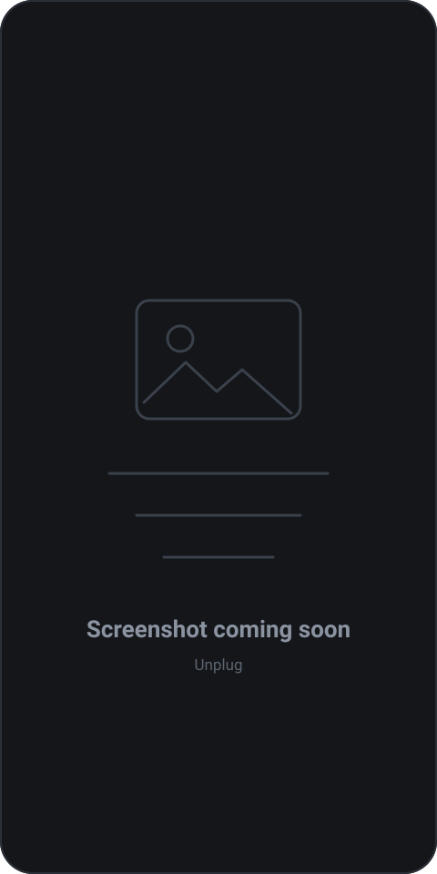

# Screenshots

**The images below are placeholders. Real screenshots and GIFs are coming soon.**

Unplug's screens are being photographed on a real device against the current
release. Until they land, every slot below shows a placeholder and names the
file it expects. Nothing on this page is a mock-up of anything the app does not
do — the descriptions match what ships.

  

---

## What's being captured

| Screen | Format | Target file |
|---|---|---|
| First run and permissions | PNG | `screenshots/onboarding.png` |
| Dashboard | PNG + GIF | `screenshots/dashboard.png`, `screenshots/dashboard.gif` |
| Groups and daily limits | PNG | `screenshots/groups.png` |
| Picking apps for a group | PNG | `screenshots/app-picker.png` |
| Blocked tabs per app | PNG | `screenshots/tab-blockers.png` |
| The lock screen | PNG | `screenshots/lock-screen.png` |
| The wait timer | GIF | `screenshots/wait-timer.gif` |
| The 50-word challenge | PNG | `screenshots/writing-challenge.png` |
| Open gate countdown | GIF | `screenshots/open-gate.gif` |
| Break reminder | GIF | `screenshots/break-reminder.gif` |
| Locked settings | PNG | `screenshots/settings.png` |
| Update banner | PNG | `screenshots/update-banner.png` |

---

## First run and permissions

Three permissions, each explained on its own card before the system dialog
appears. Usage Access, Accessibility Service, Display over other apps.

---

## Dashboard

The ring chart of today's screen time, per-group totals, and the update banner
when a new release is out.

---

## Groups and daily limits

A group, the apps inside it, its daily limit, and the two optional catches —
open gate and break reminder — at the bottom of the sheet.

---

## Picking apps for a group

The installed-app list, with search and multi-select. Groups are not limited to
social apps; the limit works on anything Android counts usage for.

---

## Blocked tabs per app

Per-app switches for Shorts, Reels, Spotlight, Stories, For You and the rest.
Each one is off until you turn it on. Also shows custom keywords.

---

## The lock screen

What you get when the limit is spent: the timer, the writing challenge, and the
one line that says how much time you have left.

---

## The wait timer

The min / sec wheel, 30 seconds to 3:59. The timer stops if you leave the app or
shrink the window.

---

## The 50-word challenge

Exact-match typing, no copy-paste. The passage is shown above the field and
checked word for word.

---

## Open gate

The five-second countdown on app launch, then **Open Instagram** or **Go back**
— which returns you home, not to the app you came from.

---

## Break reminder

The interruption after a set number of continuous minutes, and the **Close**
button that appears once the question has had five seconds to land.

---

## Locked settings

Limits, groups and blockers behind a lock. Tightening is free; loosening asks
for the wait or the challenge.

---

## Update banner

The in-app update prompt: download the APK, hand it to Android's installer,
stay in the app. The fallback link appears only if the download fails.

---

## Contributing a screenshot

Device screenshots are welcome and will be credited. Before adding one:

- Use a release build on a real device, not an emulator or a mock-up.
- Portrait, PNG or GIF, long edge at least 1080px.
- Clear any personal data: group names, app lists, notification shadows.
- Keep the status bar readable — the time and battery are useful context.
- Drop the file into `docs/screenshots/` using the name from the table above,
  then replace the matching `` on this
  page with the real file. Leave everything else alone.

README screenshots are linked from the main [README](../README.md), so a new
image shows up in two places.
